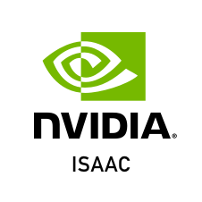

# Reefy Isaac Sim

<p align="center">
  
</p>

A Reefy APP-SPEC v2 package for running NVIDIA Isaac Sim 6.0.1 with an
interactive browser UI on an NVIDIA GPU Reefy device.

## Architecture

This repository packages one Reefy app with two cooperating services:

1. `isaac-sim` runs NVIDIA's official
   `nvcr.io/nvidia/isaac-sim:6.0.1` image with headless WebRTC streaming.
2. `web-viewer` serves NVIDIA's browser WebRTC client on TCP 8210.

Reefy manages both services as one app and one Compose project. The simulator
image is pulled directly from NVIDIA. Reefy does not rebuild or republish the
21 GB Isaac Sim image.

The viewer image is built by this repository from NVIDIA's Apache-2.0 licensed
Isaac Sim Docker viewer recipe. It uses the browser's current hostname at
runtime, so one image works with each device's LAN address. A small Node server
relays WebSocket signaling through the same Reefy app route, allowing Reefy's
HTTPS termination and token authentication to cover both the page and
signaling connection.

## Runtime behavior

- Isaac Sim: 6.0.1
- Viewer resolution: 1920x1080
- UI scale: 1.25
- Networking: Docker host network, as required by NVIDIA WebRTC streaming
- Hub Workstation Cache: disabled
- Concurrent browser clients: one
- Supported app instances per device: one, because the WebRTC ports are fixed

The Reefy app route fronts the viewer on TCP 8210. WebRTC also connects
directly to the device on these private-LAN ports:

| Port | Protocol | Purpose |
| ---: | --- | --- |
| 8210 | TCP | Browser viewer |
| 49100 | TCP | Isaac Sim signaling upstream used locally by the viewer gateway |
| 47998 | UDP | WebRTC media |

The Reefy proxy authenticates the viewer page and WebSocket signaling when the
app is opened through the normal Reefy route. UDP media remains a direct LAN
connection to port 47998. Isaac Sim still creates its TCP 49100 listener because
it uses host networking, but browsers using the Reefy route connect through the
viewer gateway instead. Run this app only on a trusted private network. Do not
expose ports 49100 or 47998 to the public Internet. Opening
`http://DEVICE-LAN-IP:8210` directly is useful for diagnostics but bypasses
Reefy authentication.

## Persistent data

Reefy stores each logical volume below the installed app instance directory.
The manifest preserves the following container paths:

| Volume | Container path | Backup policy |
| --- | --- | --- |
| `documents` | `/isaac-sim/Documents` | BorgBase |
| `data` | `/isaac-sim/.local/share/ov/data` | BorgBase |
| `config` | `/isaac-sim/.nvidia-omniverse/config` | BorgBase |
| `pkg` | `/isaac-sim/.local/share/ov/pkg` | Recreated locally |
| `cache` | `/isaac-sim/.cache` | Recreated locally |
| `compute-cache` | `/isaac-sim/.nv/ComputeCache` | Recreated locally |
| `logs` | `/isaac-sim/.nvidia-omniverse/logs` | Recreated locally |

Save authored USD files under `Documents` so they are included in Reefy app
backups. Cache and generated shader data are intentionally not backed up.

## Requirements

- x86_64 Reefy OS with APP-SPEC v2
- a supported NVIDIA RTX GPU
- the matching Reefy NVIDIA host-provider artifact for the installed firmware
- enough storage for the Isaac Sim image and application data
- LAN access to all three WebRTC ports listed above

The manifest keeps historical Reefy behavior by setting `gpu: true`, which
means NVIDIA. It also explicitly attaches `nvidia.com/gpu=all` to the simulator
service. With the current APP-SPEC v2 renderer, the primary viewer service also
receives the CDI device request. The viewer does not use it, and this is safe.

## Build the viewer

The public image is built for `linux/amd64` and published as:

```text
ghcr.io/reefyai/reefy-isaac-web-viewer:6.0.1-reefy.2
```

For a local build:

```sh
docker build -t reefy-isaac-web-viewer:dev web-viewer
```

GitHub Actions also publishes a commit-SHA tag, build provenance, and an SBOM.

## NVIDIA terms

Starting the simulator with `ACCEPT_EULA=Y` accepts NVIDIA's governing terms.
Review them before installing or running this app:

- [Isaac Sim container installation](https://docs.isaacsim.omniverse.nvidia.com/latest/installation/install_container.html)
- [Isaac Sim Additional Software and Materials License](https://www.nvidia.com/en-us/agreements/enterprise-software/isaac-sim-additional-software-and-materials-license/)
- [NVIDIA Isaac Sim NGC container](https://catalog.ngc.nvidia.com/orgs/nvidia/containers/isaac-sim)

This community integration is not affiliated with or endorsed by NVIDIA.
NVIDIA, Isaac, and related marks belong to NVIDIA Corporation.

## License

Reefy-authored source in this repository is licensed under Apache-2.0. NVIDIA
software, npm packages, container images, sample-derived code, and brand assets
remain governed by their respective NVIDIA terms. See [NOTICE](NOTICE).
